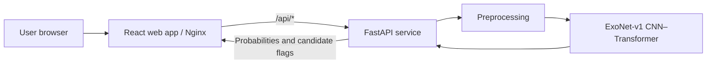

# ExoFinder

**AI-powered exoplanet transit candidate detection and light-curve analysis**

ExoFinder is a full-stack machine learning application that analyzes Kepler stellar light curves to identify signals consistent with possible exoplanet transits. It combines a PyTorch **CNN–Transformer (ExoNet-v1)** classifier, a **FastAPI** inference service, and a **React + TypeScript** web dashboard. The application supports local development, standalone **Docker Compose**, and **Kubernetes on Minikube**.

> **Scientific scope:** ExoFinder predicts *transit candidates*, not confirmed exoplanets. A positive classification requires follow-up validation and does not establish planetary status.

## Features

- Upload labeled Kepler-format CSV files and analyze multiple light curves.
- Inspect predicted candidate probabilities and light-curve visualizations in a responsive React dashboard.
- Use the FastAPI REST endpoints for single-curve or batch CSV inference.
- Run the same trained model locally, in Docker containers, or in Kubernetes.
- Deploy frontend and API independently with health checks and Kubernetes readiness/liveness probes.
- Serve React with Nginx, which reverse-proxies `/api/` requests to FastAPI.

## Technology stack

| Layer | Technologies |
| --- | --- |
| Machine learning | Python 3.11, PyTorch 2.3.1 CPU, NumPy, pandas, scikit-learn |
| Model | ExoNet-v1 CNN–Transformer |
| API | FastAPI, Uvicorn, python-multipart |
| Frontend | React, TypeScript, Vite |
| Web server / proxy | Nginx |
| Containers | Docker, Docker Compose |
| Orchestration | Kubernetes, Minikube |
| Development environment | Windows PowerShell / VS Code |

## Architecture



- **Local React development:** Vite serves the frontend and proxies API calls to the locally running FastAPI service.
- **Docker Compose:** Nginx resolves the API container by the hostname `exofinder-api` on the Compose network.
- **Kubernetes:** Nginx resolves the `exofinder-api` Kubernetes Service, and the frontend is exposed through a NodePort Service.

## Repository layout

```text
ExoFinder/
├── api/
│   └── main.py
├── src/
│   ├── train.py
│   └── evaluate_test.py
├── data/
│   ├── exoTrain.csv
│   └── exoTest.csv
├── models/
│   └── exofinder.pt
├── outputs/
│   └── training_metrics.json
├── frontend-react/
│   ├── src/
│   ├── package.json
│   └── vite.config.ts
├── frontend/                    # Legacy Streamlit frontend (optional backup)
├── k8s/
│   ├── exofinder-api.yaml
│   ├── exofinder-frontend-react.yaml
│   └── exofinder.yaml           # Legacy combined manifest; includes Streamlit
├── Dockerfile.api
├── Dockerfile.frontend
├── nginx.conf
├── docker-compose.yml
└── README.md
```

> Some folders may also contain experiments or reference implementations. The trained application loads `models/exofinder.pt` and `outputs/training_metrics.json`.

## Dataset

The model was trained using the public Kaggle **Kepler Labelled Time Series Data** dataset:

```powershell
kaggle datasets download -d keplersmachines/kepler-labelled-time-series-data -p data --unzip
```

| Split | Total samples | Non-exoplanet class | Exoplanet class |
| --- | ---: | ---: | ---: |
| Training CSV | 5,087 | 5,050 | 37 |
| Test CSV | 570 | 565 | 5 |

Each CSV has **3,198 columns**: `LABEL` followed by `FLUX.1` through `FLUX.3197`. In this dataset, `LABEL=1` is the negative class and `LABEL=2` is the positive class. The class distribution is extremely imbalanced.

## Model and evaluation

ExoNet-v1 uses convolutional feature extraction together with Transformer-based sequence modeling. Its checkpoint is stored at `models/exofinder.pt` and is loaded by the API in CPU inference mode.

### Reported results

| Metric | Result | Split |
| --- | ---: | --- |
| PR-AUC | 0.6931 | Validation |
| F1-score | 0.7692 | Validation |
| Best epoch | 13 | Validation / training |
| PR-AUC | 0.7289 | Held-out test |
| ROC-AUC | 0.9823 | Held-out test |
| Positive-class precision | 0.80 | Held-out test |
| Positive-class recall | 0.80 | Held-out test |
| Positive-class F1-score | 0.80 | Held-out test |

Validation confusion matrix: `[[1010, 1], [2, 5]]`.

Held-out test confusion matrix: `[[564, 1], [1, 4]]`.

The decision threshold is approximately **0.16**, stored in `outputs/training_metrics.json` and loaded at API startup.

**Important limitations:** The held-out test split contains only **five positive examples**. Precision, recall, F1, and ROC-AUC can therefore vary substantially with small changes in predictions. High overall accuracy is especially misleading with this class imbalance. These results are suitable for a project demonstration, not for scientific confirmation of exoplanets.

### Train and evaluate

From the repository root with the Python environment activated:

```powershell
python .\src\train.py --epochs 15 --batch-size 32
python .\src\evaluate_test.py
```

Retraining is **not required** to run the already-built Docker images or deploy the application.

## Prerequisites

- Windows with PowerShell and VS Code (commands below use PowerShell).
- Python 3.11 for local backend development.
- Node.js LTS and npm for local frontend development.
- Docker Desktop running **Linux containers** for Docker/Compose.
- Minikube and kubectl (or `minikube kubectl --`) for Kubernetes deployment.
- The trained checkpoint and training metrics files in their expected locations.

## Run locally (without Docker)

### 1. Backend

Open PowerShell in the project root:

```powershell
.\.venv\Scripts\Activate.ps1
python -m uvicorn api.main:app --host 127.0.0.1 --port 8000
```

If you do not yet have a virtual environment, create one with Python 3.11 and install the Python dependencies used by `Dockerfile.api` before starting the API.

Backend endpoints:

- API documentation: <http://127.0.0.1:8000/docs>
- Health check: <http://127.0.0.1:8000/health>
- Model details: <http://127.0.0.1:8000/model-info>

### 2. Frontend

In a **second** PowerShell terminal:

```powershell
cd .\frontend-react
npm install
npm run dev
```

Open <http://127.0.0.1:5173> (or the URL shown by Vite).

The Vite development proxy should forward `/api/` requests to the backend. If API requests fail, inspect `frontend-react/vite.config.ts` and verify that FastAPI is running on port `8000`.

## Run using Docker Compose (no Kubernetes required)

This is the simplest way to run the complete production-style application on one computer.

### 1. Build images (if needed)

From the repository root:

```powershell
docker build -f Dockerfile.api -t exofinder-api:1.0 .
docker build -f Dockerfile.frontend -t exofinder-frontend:2.0 .
```

### 2. Docker Compose configuration

Create or verify `docker-compose.yml`:

```yaml
services:
  api:
    image: exofinder-api:1.0
    container_name: exofinder-api
    ports:
      - "8000:8000"
    restart: unless-stopped
    networks:
      default:
        aliases:
          - exofinder-api

  frontend:
    image: exofinder-frontend:2.0
    container_name: exofinder-frontend
    ports:
      - "8080:80"
    depends_on:
      - api
    restart: unless-stopped
```

The network alias matches the upstream hostname used by `nginx.conf`. Both services are attached to the default Compose network.

### 3. Start and verify

```powershell
docker compose config
docker compose up -d
docker compose ps
Invoke-RestMethod http://localhost:8080/api/health
```

Open:

- **ExoFinder web app:** <http://localhost:8080>
- **FastAPI Swagger UI:** <http://localhost:8000/docs>

### 4. Manage containers

```powershell
docker compose logs -f
docker compose restart
docker compose down
```

`docker compose down` stops and removes the Compose-managed containers and network; it does not delete the Docker images.

> If `docker compose up -d` reports an existing container-name conflict, first inspect `docker ps -a`. Remove only conflicting *standalone* ExoFinder containers you no longer need, for example `docker rm -f exofinder-api exofinder-frontend`. Do not remove unrelated lab containers.

## Run on Kubernetes with Minikube

Kubernetes deployment uses the same Docker images as Docker Compose.

### 1. Check Minikube

```powershell
$env:Path += ";C:\Program Files\Kubernetes\Minikube"
minikube status
minikube kubectl -- get nodes
```

The PATH command is needed only in terminals that cannot already find `minikube`.

### 2. Load images into Minikube

```powershell
minikube image load exofinder-api:1.0
minikube image load exofinder-frontend:2.0
minikube image ls
```

### 3. Deploy the API and React frontend

```powershell
minikube kubectl -- apply -f k8s/exofinder-api.yaml
minikube kubectl -- apply -f k8s/exofinder-frontend-react.yaml
```

**Do not reapply `k8s/exofinder.yaml` after deploying React** if that older manifest still contains the Streamlit frontend Deployment; doing so could revert the frontend configuration.

### 4. Verify deployments

```powershell
minikube kubectl -- rollout status deployment/exofinder-api --timeout=180s
minikube kubectl -- rollout status deployment/exofinder-frontend --timeout=180s
minikube kubectl -- get pods
minikube kubectl -- get services
```

Both ExoFinder pods should reach `1/1 Running` / Ready.

### 5. Open the application

```powershell
minikube service exofinder-frontend --url
```

Open the printed URL in a browser. **On Windows with Minikube's Docker driver, leave this terminal open** while accessing the app because it maintains the service tunnel.

Check the API through the frontend proxy (replace the URL with the one printed by Minikube):

```powershell
Invoke-RestMethod http://127.0.0.1:<PORT>/api/health
```

Here `<PORT>` is a placeholder, not a literal port number.

## API reference

| Method | Endpoint | Description |
| --- | --- | --- |
| `GET` | `/health` | Returns service status and model architecture |
| `GET` | `/model-info` | Returns architecture, input length, and decision threshold |
| `POST` | `/predict` | Scores one light curve using a JSON `flux` array |
| `POST` | `/predict-csv` | Scores a labeled CSV containing 1–1,000 light curves |

### Example: health check

```powershell
Invoke-RestMethod http://localhost:8000/health
```

Expected structure:

```json
{"status":"ok","model":"ExoNet-v1"}
```

### CSV requirements

- Column order: `LABEL`, `FLUX.1`, ..., `FLUX.3197`.
- Between **1 and 1,000 rows per API request**.
- The API may enforce a **15 MB or 50 MB upload limit**, depending on whether `api/main.py` was updated. Check the active `predict_csv` implementation.
- The React UI can split large datasets into smaller batches to avoid request-size limits.
- Each prediction contains an `index`, a `probability`, and a boolean `candidate` flag.

## Docker and Kubernetes comparison

| Capability | Docker Compose | Kubernetes |
| --- | --- | --- |
| Run frontend and backend | Yes | Yes |
| Service-to-service networking | Compose network | Kubernetes Services |
| Container restart | Restart policy | Pod reconciliation and probes |
| Horizontal autoscaling | Not built in | HPA when configured |
| Rolling deployment | Manual / additional tooling | Deployment rollout support |
| Best use | Local demos and development | Architecture and orchestration demos |

**Note:** HPA, persistent prediction history, and observability dashboards are **possible extensions**, not features confirmed to be implemented in the current manifests.

## Troubleshooting

| Symptom | What to check |
| --- | --- |
| `minikube` is not recognized | Add `C:\Program Files\Kubernetes\Minikube` to the current PowerShell PATH |
| Docker image missing | Run `docker images`, build the correct image/tag, and load it into Minikube if deploying to Kubernetes |
| Docker build hash mismatch | Retry on a reliable network; do not bypass pip integrity checks |
| `docker compose ps` is empty | Run `docker compose up -d` |
| Frontend returns `502 Bad Gateway` | Verify the API container/pod is healthy and `nginx.conf` targets `exofinder-api:8000` |
| CSV upload returns `413` | Check Nginx `client_max_body_size`, FastAPI upload limit, and frontend batching |
| Pods show `0/1` Ready | Check `minikube kubectl -- describe pods -l app=exofinder-api` and deployment logs |
| React shows old Streamlit UI | Ensure the React image tag `2.0` and the React Kubernetes manifest are deployed |
| Minikube URL stops working | Re-run `minikube service exofinder-frontend --url` and leave its terminal open |

Useful diagnostics:

```powershell
docker compose logs --tail=100
minikube kubectl -- logs deployment/exofinder-api
minikube kubectl -- logs deployment/exofinder-frontend
```

## Future enhancements

- Horizontal Pod Autoscaler (HPA) with CPU metrics and load testing.
- Self-healing and rolling-update demonstrations.
- Prometheus/Grafana monitoring and structured application logs.
- Asynchronous background jobs for large datasets.
- PostgreSQL-backed prediction history and user authentication.
- Model calibration, cross-validation, and more rigorous evaluation on additional astronomical datasets.

## Acknowledgments

- Public Kepler labeled light-curve dataset distributed on Kaggle.
- Open-source ecosystems: PyTorch, FastAPI, React, Docker, and Kubernetes.

## License

No license is specified in this README. Add a `LICENSE` file if you decide to publish or redistribute the project under an open-source license. Review the dataset and any reference-code licenses separately before redistribution.
